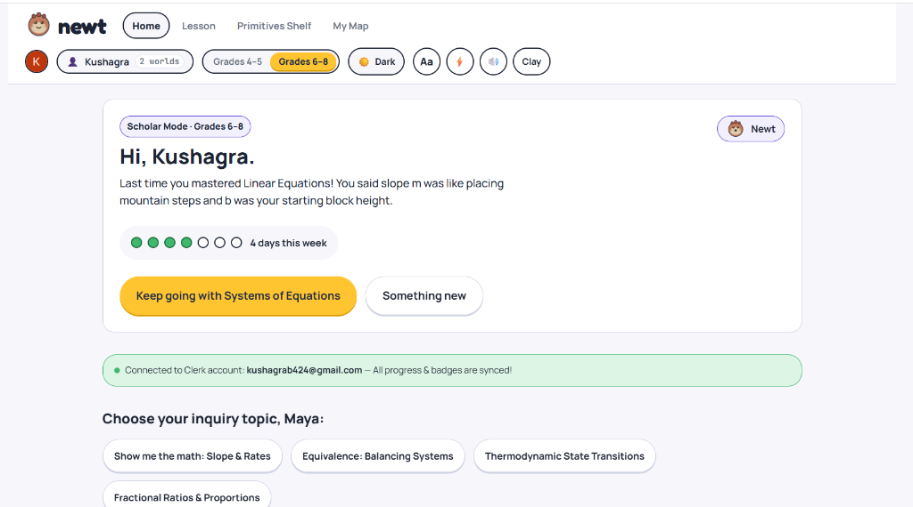

# Newt: Interactive Classroom Math and Science Tutor

An inquiry-driven learning platform for students in grades 4 through 8, designed to explain the conceptual intuition behind math and science before introducing formulas.



---

## Overview

Newt is a single-page web application that bridges the gap between visual intuition and abstract mathematics. Instead of rote memorization, students manipulate dynamic visual primitives (balance scales, coordinate graphs, particle chambers) to discover underlying principles before formalizing them into equations.

The application adapts its pedagogical vocabulary based on the student's selected grade level:
- **Explorer Mode (Grades 4-5):** Grounded in tangible metaphors, visual models, and discovery-based terminology.
- **Scholar Mode (Grades 6-8):** Emphasizes formal mathematical notation, coordinate geometry, and algebraic rigor.

---

## Key Features

### 1. Interactive Visual Primitives
- **Coordinate Plane:** Real-time graphing tool demonstrating how the slope parameter (m) determines steepness and trajectory, and how the y-intercept (b) shifts the vertical starting position.
- **Balance Scale:** Two-pan mechanical scale simulating algebraic equivalence, illustrating why operations must be performed symmetrically across both sides of an equation.
- **Fraction Bars:** Segmented proportional visualizer for comparing unequal denominators and demonstrating equivalent fractions.
- **Number Line:** Directional jump simulator for integer operations, positive and negative displacements, and distance.
- **Particle Chamber:** Kinetic simulation showing thermodynamic phase changes (solid, liquid, gas) driven by thermal energy.

### 2. Six-Stage Lesson Arc
Every curriculum topic follows a structured pedagogical progression:
1. **Big Idea:** Real-world intuition and grounding question.
2. **Why It Matters:** Practical relevance and motivation.
3. **Interactive Visualizer:** Direct manipulation of the concept primitive.
4. **Guided Example:** Step-by-step walkthrough connecting visualization to mathematical notation.
5. **Check Understanding:** Formative assessment question with adaptive hints.
6. **Practice Challenge:** Target problem requiring students to achieve numerical or visual balance.

### 3. Contextual Personalization
- **Interest-Based Scaffolding:** Lessons dynamically adapt narrative analogies to match student interests (including Minecraft, Soccer, Space, Baking, Robotics, and Nature).
- **Adaptive Memory:** The system references prior student insights and past accomplishments during new lesson introductions.

### 4. Authentication and Progress Synchronization
- **Clerk Authentication:** Integrated user management supporting email and one-click Google sign-in.
- **Per-User Progress Isolation:** Mastery records, active topics, learning streaks, and accessibility preferences are tracked uniquely per authenticated account.
- **Guest Session Migration:** Students can begin exploring immediately without an account; when signing in, guest progress is automatically migrated to their authenticated profile.

### 5. Accessibility and Universal Design
- **Dyslexia Support:** Integrated Lexend font option designed to improve visual reading flow.
- **Reduced Motion:** Optional transition suppression for users sensitive to motion effects.
- **Dual Visual Themes:** Complete light and dark themes tailored for both grade modes.
- **Speech Synthesis and Voice Input:** Native Web Speech API integration for interactive talkback and speech-to-text response entry.

---

## Technology Stack

- **Frontend Library:** React 19
- **Language:** TypeScript 5.8
- **Build System:** Vite 8
- **Authentication:** Clerk (`@clerk/react`)
- **Linting:** Oxlint
- **Visual Effects:** Canvas Confetti
- **Styling:** Modular CSS Tokens and Custom Properties

---

## Project Structure

```
Newt/
├── docs/
│   └── screenshot.png         # Documentation screenshot
├── public/
│   ├── favicon.svg            # Application icon
│   ├── icons.svg              # SVG icon sprite
│   └── newt-mascot.svg        # Vector mascot asset
├── src/
│   ├── auth/
│   │   └── ClerkAuthProvider.tsx # Clerk authentication context and wrapper
│   ├── components/
│   │   ├── Auth/              # Sign-in and account controls
│   │   ├── Chat/              # Dialogue and tutor bubbles
│   │   ├── Feedback/          # Correctness banners and hints
│   │   ├── Header/            # Top navigation and accessibility controls
│   │   ├── Home/              # Welcome card and streak tracker
│   │   ├── Input/             # Multi-modal response box
│   │   ├── Mascot/            # Visual mascot avatar component
│   │   ├── Navigation/        # Lesson path step indicator
│   │   ├── Onboarding/        # Student interest and grade profile picker
│   │   ├── Primitives/        # Coordinate plane, scale, fraction bars, particles
│   │   └── Whiteboard/        # Conceptual drawing and formula stage
│   ├── data/
│   │   └── topics.ts          # Curriculum definitions and prerequisite tree
│   ├── styles/
│   │   ├── base.css           # Global reset and typography
│   │   └── tokens.css         # Color palettes, geometry, and design tokens
│   ├── utils/
│   │   ├── audio.ts           # Web Audio API sound synthesis
│   │   └── userProgress.ts    # Per-user scoped progress persistence
│   ├── views/
│   │   ├── CelebrationView.tsx# Mastery rewards screen
│   │   ├── HomeView.tsx       # Student dashboard and topic selector
│   │   ├── LessonView.tsx     # Active interactive lesson view
│   │   ├── MapView.tsx        # Concept curriculum map
│   │   └── ShelfView.tsx      # Open-ended math tool sandbox
│   ├── App.tsx                # Application root and state orchestrator
│   └── main.tsx               # DOM mount point
├── .env.example               # Template environment configuration
├── package.json               # Dependencies and scripts
├── tsconfig.json              # TypeScript compilation configuration
├── vercel.json                # Single-page routing configuration
└── vite.config.ts             # Vite build pipeline
```

---

## Getting Started

### Prerequisites
- Node.js version 20 or higher
- npm version 10 or higher

### Installation

1. Clone the repository:
   ```bash
   git clone https://github.com/KushagraB424/Newt.git
   cd Newt
   ```

2. Install dependencies:
   ```bash
   npm install
   ```

3. Configure environment variables:
   Create a `.env.local` file in the root directory:
   ```bash
   cp .env.example .env.local
   ```

   Populate your Clerk Publishable Key:
   ```env
   VITE_CLERK_PUBLISHABLE_KEY=pk_test_your_clerk_key
   ```
   *(If omitted, the platform will automatically run in local Guest Mode).*

### Development

Start the local development server with Hot Module Replacement:
```bash
npm run dev
```
Open `http://localhost:5173` in your browser.

### Production Build

Compile and type-check the application for production:
```bash
npm run build
```
Optimized assets will be generated in the `dist/` directory.

To test the production build locally:
```bash
npm run preview
```

### Code Quality

Run the static analysis linter:
```bash
npm run lint
```

---

## Deployment

### Vercel Deployment (Recommended)

1. Push your repository to GitHub.
2. Import the project in Vercel.
3. In **Project Settings** > **Environment Variables**, add:
   - **Key:** `VITE_CLERK_PUBLISHABLE_KEY`
   - **Value:** Your Clerk publishable key (`pk_test_...` or `pk_live_...`)
   - **Type:** Config
4. Deploy. Client-side routing is automatically handled via `vercel.json`.

### Static Hosting (AWS S3 + CloudFront)

1. Generate the distribution bundle:
   ```bash
   npm run build
   ```
2. Upload the contents of `dist/` to an Amazon S3 bucket configured for static web hosting:
   ```bash
   aws s3 sync dist/ s3://your-bucket-name --delete
   ```
3. Set CloudFront Custom Error Responses:
   - HTTP Error Code: `403` and `404`
   - Response Page Path: `/index.html`
   - HTTP Response Code: `200`

---

## License

This project is licensed under the MIT License. See the [LICENSE](./LICENSE) file for complete terms.
